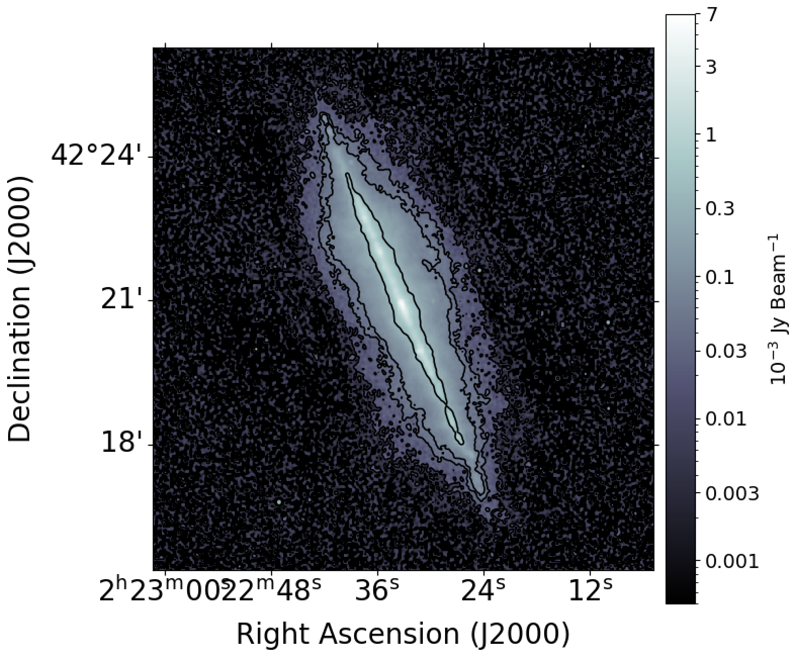

# Creating a Total Intensity Radio Map of a Galaxy

## Overview

This Python code generates a **total intensity radio map (Stokes I)** of a galaxy using a Stokes I FITS file.

The code uses a user-specified noise level, measured from the input FITS file, to generate and overlay **three total intensity contours** on the radio map.

## Input

- **Stokes I FITS file:** Contains the radio total intensity data of the galaxy.
- **Noise level :** The RMS noise measured from the FITS image.

## Output

- A **Stokes I radio intensity map** of the galaxy.
- Three overlaid total intensity contours based on the specified noise level.

## Features

- Reads and processes radio astronomy FITS images.
- Visualizes the galaxy's total intensity radio emission.
- Overlays three noise-based intensity contours to highlight the galaxy's radio emission structure.

## Example Output

The following image shows an example of the generated total intensity radio map with three overlaid contours.

